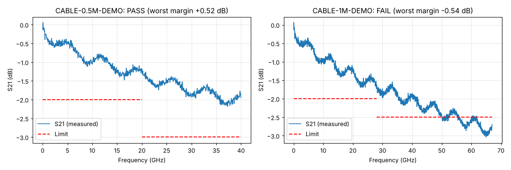

# PyQt VNA Test Demo

A small desktop test application I built to learn PyQt. It runs a VNA insertion-loss (S21) sweep against a configurable product, plots the trace against limit lines, and gives a PASS/FAIL verdict.

It runs against a **simulated VNA** by default. A PyVISA/SCPI driver is included as a starting point for a real instrument, but it hasn't been tested against hardware.



## What it demonstrates

- **Responsive GUI during slow instrument calls.** Sweeps run in a `QThread` worker and report back through signals, so the window never freezes.
- **Swappable hardware.** The GUI talks only to an `Instrument` interface; `SimulatedVNA` and `VisaVNA` are interchangeable.
- **Configuration-driven products.** Parts, sweep settings, and limit lines live in `config/products.json`. Adding a part needs no code change.
- **Testable core.** Instrument, config, and pass/fail logic have no Qt dependency and are covered by unit tests.

## Project layout

```
app.py                  entry point (simulated VNA by default, --visa for real hardware)
config/products.json    product definitions: sweep settings and limit lines
vna_demo/
  instrument.py         Instrument interface, SimulatedVNA, VisaVNA (PyVISA + SCPI)
  config.py             loads and validates product definitions
  analysis.py           pass/fail against limit segments, worst-case margin
  worker.py             QThread worker that runs a sweep off the GUI thread
  main_window.py        operator window: part selector, run button, plot, verdict, log
tests/test_core.py      unit tests for the non-GUI layers
```

## Running it

```bash
python -m venv .venv
# Windows: .venv\Scripts\activate    macOS/Linux: source .venv/bin/activate
pip install -r requirements.txt

python app.py                 # simulated VNA
python -m pytest              # unit tests
```

With a real instrument (requires a VISA backend such as NI-VISA or `pyvisa-py`):

```bash
python app.py --visa TCPIP0::192.168.1.50::inst0::INSTR
```

## Adding a product

Add an entry to `config/products.json`:

```json
{
  "part_number": "NEW-PART",
  "description": "What it is",
  "sweep": { "start_hz": 10e6, "stop_hz": 50e9, "points": 1001 },
  "limits": [ { "start_hz": 10e6, "stop_hz": 50e9, "min_db": -3.0 } ]
}
```

## Ideas for next steps

- Save results to CSV or Touchstone (`.s2p`) with part number, serial number, and timestamp
- Operator login and serial-number entry before each sweep
- Return-loss (S11) limits alongside insertion loss
- A sequence of steps per product (calibrate, sweep, evaluate) defined in config
